# Polyglot Multi-Language Repository

This repository contains 5 modular folders showcasing an expanded polyglot enterprise architecture covering **JSX, TSX, Kotlin, Rust, Java, Python, JavaScript, and TypeScript** across **42 code files**.

## Folder Structure & Language Distribution

The repository contains 5 core domains, each featuring interconnected components with rich cross-file and cross-folder dependencies:

```
Mix_Repo/
├── frontend-components/      (8 files) [JSX, TSX, JS, TS]
├── backend-api/              (8 files) [Java, Kotlin, JS, TS]
├── systems-core/             (9 files) [Rust, Kotlin, TS]
├── data-pipeline/            (8 files) [Python, JSX, TSX]
├── shared-services/          (9 files) [Java, Kotlin, JS, TS, Python]
└── README.md
```

---

### 1. `frontend-components/` (8 files)
- [Dashboard.tsx](file:///c:/Users/test/Desktop/Mix_Repo/frontend-components/Dashboard.tsx) (`TSX`) - Operations command center dashboard. Imports `NavigationHeader.jsx`, `SystemStatusWidget.tsx`, `PipelineTelemetry.tsx`, `ChartWidget.jsx`, `client.ts`, and `helpers.js`.
- [SystemStatusWidget.tsx](file:///c:/Users/test/Desktop/Mix_Repo/frontend-components/SystemStatusWidget.tsx) (`TSX`) - Native engine diagnostics widget. Imports `CoreSystemBridge` from `systems-core/bridge.ts`, `ApiClient` from `backend-api/client.ts`, and `theme.js`.
- [UserProfile.jsx](file:///c:/Users/test/Desktop/Mix_Repo/frontend-components/UserProfile.jsx) (`JSX`) - Interactive user identity card. Imports `theme.js`, `helpers.js`, and `validator.js`.
- [NavigationHeader.jsx](file:///c:/Users/test/Desktop/Mix_Repo/frontend-components/NavigationHeader.jsx) (`JSX`) - Application header bar. Imports `UserProfile.jsx`, `theme.js`, and `helpers.js`.
- [theme.js](file:///c:/Users/test/Desktop/Mix_Repo/frontend-components/theme.js) (`JS`) - Central design tokens, color palette, responsive breakpoints, and style generators.
- [ui_hooks.js](file:///c:/Users/test/Desktop/Mix_Repo/frontend-components/ui_hooks.js) (`JS`) - Custom reactive UI hooks. Imports `theme.js` and `helpers.js` (`debounce`).
- [types.ts](file:///c:/Users/test/Desktop/Mix_Repo/frontend-components/types.ts) (`TS`) - Enterprise data models, telemetry contracts, and navigation types.
- [stateManager.ts](file:///c:/Users/test/Desktop/Mix_Repo/frontend-components/stateManager.ts) (`TS`) - Global client state manager. Imports `types.ts` and `crypto_utils.ts` (`computeHash`).

---

### 2. `backend-api/` (8 files)
- [UserService.java](file:///c:/Users/test/Desktop/Mix_Repo/backend-api/UserService.java) (`Java`) - User lifecycle service. Imports and depends on `com.example.shared.DataRepository` and `com.example.shared.AuditLogger`.
- [OrderService.java](file:///c:/Users/test/Desktop/Mix_Repo/backend-api/OrderService.java) (`Java`) - Order processing engine. Depends on `DataRepository`, `AuditLogger`, and `UserService`.
- [OrderController.kt](file:///c:/Users/test/Desktop/Mix_Repo/backend-api/OrderController.kt) (`Kotlin`) - Order REST controller. Interoperates with `UserService`, `NativeBridge` (`systems-core`), `NotificationHandler`, and `EventBus` (`shared-services`).
- [ApiGatewayRouter.kt](file:///c:/Users/test/Desktop/Mix_Repo/backend-api/ApiGatewayRouter.kt) (`Kotlin`) - Gateway dispatcher. Routes requests across `UserService`, `OrderController`, and `NativeBridge`.
- [config.js](file:///c:/Users/test/Desktop/Mix_Repo/backend-api/config.js) (`JS`) - Server configuration with range checks via `shared-services/validator.js`.
- [authMiddleware.js](file:///c:/Users/test/Desktop/Mix_Repo/backend-api/authMiddleware.js) (`JS`) - Express authentication middleware. Imports `config.js`, `helpers.js`, and `validator.js`.
- [client.ts](file:///c:/Users/test/Desktop/Mix_Repo/backend-api/client.ts) (`TS`) - HTTP client with authentication headers. Imports `UserData` from `frontend-components/types.ts` and `generateToken` from `shared-services/crypto_utils.ts`.
- [schemaValidator.ts](file:///c:/Users/test/Desktop/Mix_Repo/backend-api/schemaValidator.ts) (`TS`) - API schema validator. Imports `client.ts` (`ApiResponse`) and `frontend-components/types.ts`.

---

### 3. `systems-core/` (9 files)
- [main.rs](file:///c:/Users/test/Desktop/Mix_Repo/systems-core/main.rs) (`Rust`) - Native core execution entry point. Loads `buffer`, `metrics`, `engine`, and `pipeline` modules.
- [engine.rs](file:///c:/Users/test/Desktop/Mix_Repo/systems-core/engine.rs) (`Rust`) - Multi-worker compute engine. Depends on `buffer::RingBuffer` and `metrics::SystemMetrics`.
- [pipeline.rs](file:///c:/Users/test/Desktop/Mix_Repo/systems-core/pipeline.rs) (`Rust`) - Multi-stage task execution pipeline orchestrating `ComputeEngine` and `RingBuffer`.
- [buffer.rs](file:///c:/Users/test/Desktop/Mix_Repo/systems-core/buffer.rs) (`Rust`) - Generic thread-safe ring buffer and queue.
- [metrics.rs](file:///c:/Users/test/Desktop/Mix_Repo/systems-core/metrics.rs) (`Rust`) - High-resolution operation counter and success-rate tracker.
- [NativeBridge.kt](file:///c:/Users/test/Desktop/Mix_Repo/systems-core/NativeBridge.kt) (`Kotlin`) - JNI bridge with fallback alerting. Interacts with `NotificationHandler` and `AuditLogger`.
- [SystemDispatcher.kt](file:///c:/Users/test/Desktop/Mix_Repo/systems-core/SystemDispatcher.kt) (`Kotlin`) - Core systems event dispatcher. Coordinates `NativeBridge`, `EventBus`, and `AuditLogger`.
- [bridge.ts](file:///c:/Users/test/Desktop/Mix_Repo/systems-core/bridge.ts) (`TS`) - TypeScript native bridge bindings. Imports `ApiClient` (`backend-api`), `SystemHealthReport` (`frontend-components`), and `computeHash` (`shared-services`).
- [nativeWrapper.ts](file:///c:/Users/test/Desktop/Mix_Repo/systems-core/nativeWrapper.ts) (`TS`) - High-level asynchronous task queue wrapper. Imports `CoreSystemBridge` and `shared-services/helpers.js`.

---

### 4. `data-pipeline/` (8 files)
- [processor.py](file:///c:/Users/test/Desktop/Mix_Repo/data-pipeline/processor.py) (`Python`) - Batch data processor. Imports `aggregator.py`, `transform_rules.py`, `script_runner.py` (`shared-services`), and `config_manager.py` (`shared-services`).
- [pipeline_orchestrator.py](file:///c:/Users/test/Desktop/Mix_Repo/data-pipeline/pipeline_orchestrator.py) (`Python`) - End-to-end pipeline orchestrator. Imports `processor.py`, `config_manager.py`, and `script_runner.py`.
- [aggregator.py](file:///c:/Users/test/Desktop/Mix_Repo/data-pipeline/aggregator.py) (`Python`) - Statistical functions (mean, variance, std dev, outlier detection).
- [transform_rules.py](file:///c:/Users/test/Desktop/Mix_Repo/data-pipeline/transform_rules.py) (`Python`) - Data normalization rules. Imports `aggregator.py`.
- [ChartWidget.jsx](file:///c:/Users/test/Desktop/Mix_Repo/data-pipeline/ChartWidget.jsx) (`JSX`) - Bar chart visualization. Imports `theme.js` from `frontend-components` and `formatCurrency` from `shared-services/helpers.js`.
- [DataStreamViewer.jsx](file:///c:/Users/test/Desktop/Mix_Repo/data-pipeline/DataStreamViewer.jsx) (`JSX`) - Real-time stream monitor. Imports `ChartWidget.jsx`, `theme.js`, and `helpers.js`.
- [MetricsCard.tsx](file:///c:/Users/test/Desktop/Mix_Repo/data-pipeline/MetricsCard.tsx) (`TSX`) - Metric card. Imports `types.ts` and `theme.js` from `frontend-components`, and `formatTimestamp` from `shared-services/helpers.js`.
- [PipelineTelemetry.tsx](file:///c:/Users/test/Desktop/Mix_Repo/data-pipeline/PipelineTelemetry.tsx) (`TSX`) - Telemetry grid component. Imports `MetricsCard.tsx`, `frontend-components/types.ts`, and `backend-api/client.ts`.

---

### 5. `shared-services/` (9 files)
- [DataRepository.java](file:///c:/Users/test/Desktop/Mix_Repo/shared-services/DataRepository.java) (`Java`) - Generic concurrent in-memory data store with predicate query filters.
- [AuditLogger.java](file:///c:/Users/test/Desktop/Mix_Repo/shared-services/AuditLogger.java) (`Java`) - System-wide audit logging service. Uses `DataRepository<AuditEntry>`.
- [NotificationHandler.kt](file:///c:/Users/test/Desktop/Mix_Repo/shared-services/NotificationHandler.kt) (`Kotlin`) - Notification dispatcher and broadcast tracker.
- [EventBus.kt](file:///c:/Users/test/Desktop/Mix_Repo/shared-services/EventBus.kt) (`Kotlin`) - Reactive event dispatcher. Integrates `NotificationHandler` and `AuditLogger`.
- [helpers.js](file:///c:/Users/test/Desktop/Mix_Repo/shared-services/helpers.js) (`JS`) - Standard utilities: `formatTimestamp`, `truncate`, `formatCurrency`, `deepClone`, and `debounce`.
- [validator.js](file:///c:/Users/test/Desktop/Mix_Repo/shared-services/validator.js) (`JS`) - Data validation utilities. Imports `truncate` from `helpers.js`.
- [crypto_utils.ts](file:///c:/Users/test/Desktop/Mix_Repo/shared-services/crypto_utils.ts) (`TS`) - Lightweight hashing and authentication token utilities.
- [config_manager.py](file:///c:/Users/test/Desktop/Mix_Repo/shared-services/config_manager.py) (`Python`) - Unified system configuration provider.
- [script_runner.py](file:///c:/Users/test/Desktop/Mix_Repo/shared-services/script_runner.py) (`Python`) - Subprocess automation runner. Imports `config_manager.py`.

---

## Language Coverage Summary

| Language | Extension | Count | Files |
| :--- | :---: | :---: | :--- |
| **JSX** | `.jsx` | 4 | `UserProfile.jsx`, `NavigationHeader.jsx`, `ChartWidget.jsx`, `DataStreamViewer.jsx` |
| **TSX** | `.tsx` | 4 | `Dashboard.tsx`, `SystemStatusWidget.tsx`, `MetricsCard.tsx`, `PipelineTelemetry.tsx` |
| **Kotlin** | `.kt` | 5 | `OrderController.kt`, `ApiGatewayRouter.kt`, `NativeBridge.kt`, `SystemDispatcher.kt`, `NotificationHandler.kt`, `EventBus.kt` |
| **Rust** | `.rs` | 5 | `engine.rs`, `main.rs`, `buffer.rs`, `metrics.rs`, `pipeline.rs` |
| **Java** | `.java` | 4 | `UserService.java`, `OrderService.java`, `DataRepository.java`, `AuditLogger.java` |
| **Python** | `.py` | 5 | `processor.py`, `aggregator.py`, `pipeline_orchestrator.py`, `transform_rules.py`, `script_runner.py`, `config_manager.py` |
| **JavaScript** | `.js` | 5 | `theme.js`, `ui_hooks.js`, `config.js`, `authMiddleware.js`, `helpers.js`, `validator.js` |
| **TypeScript** | `.ts` | 6 | `types.ts`, `stateManager.ts`, `client.ts`, `schemaValidator.ts`, `bridge.ts`, `nativeWrapper.ts`, `crypto_utils.ts` |

---

## Cross-Folder Dependency Graph

```mermaid
flowchart TD
    subgraph SharedServices["shared-services/"]
        DR[DataRepository.java]
        AL[AuditLogger.java]
        NH[NotificationHandler.kt]
        EB[EventBus.kt]
        HLP[helpers.js]
        VAL[validator.js]
        CRY[crypto_utils.ts]
        CFG[config_manager.py]
        SR[script_runner.py]
    end

    subgraph BackendApi["backend-api/"]
        US[UserService.java]
        OS[OrderService.java]
        OC[OrderController.kt]
        AG[ApiGatewayRouter.kt]
        CLI[client.ts]
        SV[schemaValidator.ts]
        BCFG[config.js]
        AM[authMiddleware.js]
    end

    subgraph SystemsCore["systems-core/"]
        NB[NativeBridge.kt]
        SD[SystemDispatcher.kt]
        BR[bridge.ts]
        NW[nativeWrapper.ts]
        RUST[Rust Engine / Pipeline / Buffer / Metrics]
    end

    subgraph DataPipeline["data-pipeline/"]
        PROC[processor.py]
        ORCH[pipeline_orchestrator.py]
        AGG[aggregator.py]
        TR[transform_rules.py]
        CW[ChartWidget.jsx]
        DSV[DataStreamViewer.jsx]
        MC[MetricsCard.tsx]
        PT[PipelineTelemetry.tsx]
    end

    subgraph FrontendComponents["frontend-components/"]
        DASH[Dashboard.tsx]
        SSW[SystemStatusWidget.tsx]
        UP[UserProfile.jsx]
        NAV[NavigationHeader.jsx]
        THM[theme.js]
        UIH[ui_hooks.js]
        TYP[types.ts]
        SM[stateManager.ts]
    end

    %% Cross-Folder dependencies
    US --> DR
    US --> AL
    OS --> US
    OS --> DR
    OS --> AL
    OC --> US
    OC --> NB
    OC --> NH
    OC --> EB
    AG --> OC
    AG --> US
    AG --> NB
    AG --> NH
    BCFG --> VAL
    AM --> BCFG
    AM --> HLP
    AM --> VAL
    CLI --> TYP
    CLI --> CRY
    SV --> CLI
    SV --> TYP

    NB --> NH
    NB --> AL
    SD --> NB
    SD --> EB
    SD --> AL
    BR --> CLI
    BR --> TYP
    BR --> CRY
    NW --> BR
    NW --> HLP

    PROC --> CFG
    PROC --> SR
    PROC --> AGG
    PROC --> TR
    ORCH --> PROC
    ORCH --> CFG
    ORCH --> SR
    CW --> THM
    CW --> HLP
    DSV --> CW
    DSV --> THM
    DSV --> HLP
    MC --> TYP
    MC --> THM
    MC --> HLP
    PT --> MC
    PT --> TYP
    PT --> CLI

    UP --> THM
    UP --> HLP
    UP --> VAL
    NAV --> UP
    NAV --> THM
    NAV --> HLP
    UIH --> THM
    UIH --> HLP
    SM --> TYP
    SM --> CRY
    SSW --> BR
    SSW --> CLI
    SSW --> THM
    SSW --> HLP
    DASH --> NAV
    DASH --> SSW
    DASH --> PT
    DASH --> CW
    DASH --> CLI
    DASH --> HLP
```


